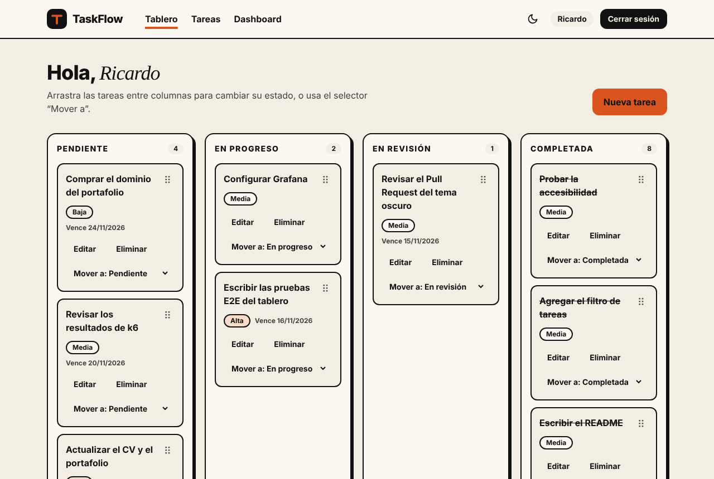
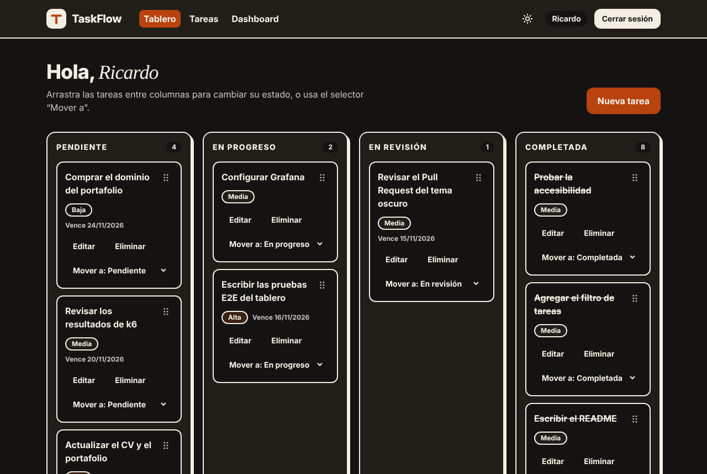
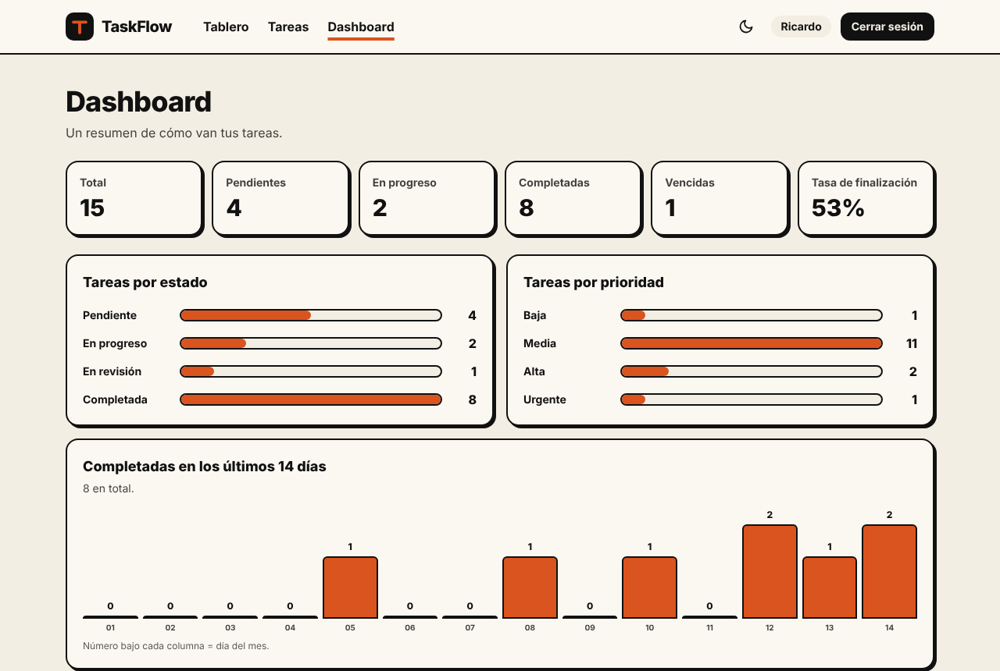
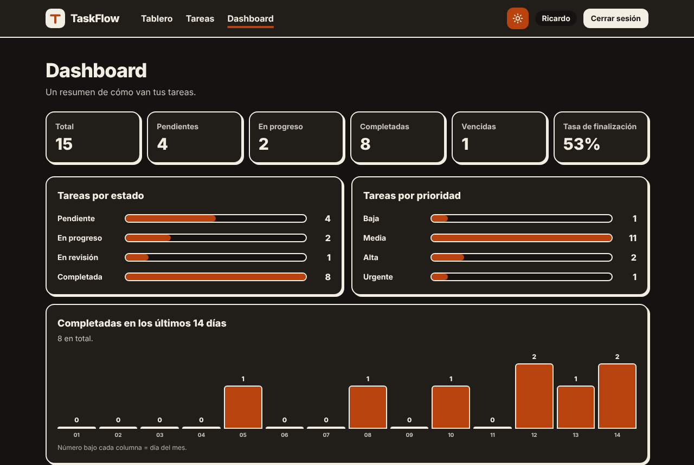
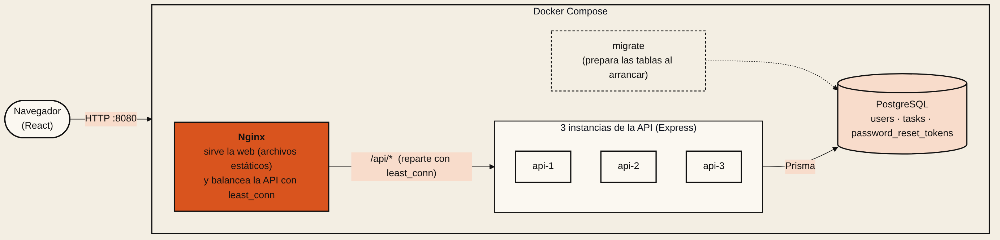

# 🗂️ TaskFlow


Aplicación web full stack para gestionar tareas personales con un tablero Kanban y un dashboard de productividad. Es un proyecto de portafolio para practicar diseño de interfaces, lógica de negocio, seguridad, pruebas automatizadas y escalabilidad.

> 🌐 **Demo en vivo:** https://taskflow-lrr4.onrender.com — entra con `demo@taskflow.dev` / `Demo-Task#2026`. Es un plan gratuito: la primera visita puede tardar cerca de 1 minuto en despertar.

| Tema claro                                                    | Tema oscuro                                                     |
| ------------------------------------------------------------- | --------------------------------------------------------------- |
|      |      |
|  |  |

## 📦 Tecnologías

- **Frontend:** React, TypeScript, Vite, React Router, TanStack Query, React Hook Form, Tailwind CSS
- **Backend:** Node.js, Express, Prisma, PostgreSQL
- **Validación:** Zod (el mismo esquema en frontend y backend)
- **Pruebas:** Vitest, React Testing Library, Supertest, Playwright (con axe-core para accesibilidad), k6
- **Infraestructura:** Docker, Nginx (balanceo de carga), GitHub Actions (CI), Prometheus y Grafana
- **Demo:** Render (aplicación) y Neon (base de datos)

## ✨ Funcionalidades

- **Crear una cuenta** con una contraseña segura (mínimo 10 caracteres, mayúscula, minúscula, número y símbolo).
- **Iniciar y cerrar sesión**, con la sesión guardada en una cookie protegida.
- **Recuperar la contraseña** con un enlace de un solo uso que dura 30 minutos.
- **Crear, editar y eliminar tareas** con título, descripción, estado, prioridad y fecha límite. Antes de eliminar se pide confirmación.
- **Ver las tareas en un tablero** de 4 columnas (Pendiente, En progreso, En revisión, Completada), con aviso de las vencidas.
- **Mover tareas entre columnas** arrastrándolas o con el selector “Mover a”. El cambio se ve al instante y, si el servidor falla, la tarea vuelve a su columna y se avisa.
- **Buscar, filtrar y ordenar** en la pantalla “Tareas”: por texto, estado, prioridad, rango de fechas y “solo vencidas”, con paginación de 10 en 10. Los filtros quedan en la dirección, así se pueden guardar o compartir.
- **Ver su progreso en un dashboard**: total, pendientes, en progreso, completadas, vencidas y tasa de finalización, con gráficos por estado, por prioridad y de lo completado en los últimos 14 días.
- **Elegir el tema claro u oscuro** con un botón. Se recuerda la elección y, si no hay una, se usa la del sistema.
- **Recibir avisos** dentro de la app y ver pantallas de carga, vacío y error.

## ⌨️ Atajos de teclado

Todavía no hay atajos propios, pero toda la app se puede usar con el teclado: `Tab` recorre los elementos, `Esc` cierra las ventanas y el selector “Mover a” de cada tarjeta mueve una tarea sin arrastrar.

## 🏗️ Arquitectura



Nginx sirve la web y reparte las peticiones de la API entre 3 instancias de Express, que comparten una base de datos PostgreSQL. Los demás diagramas (sesión, modelo de datos, despliegue y pruebas de carga) están en [`docs/arquitectura.md`](docs/arquitectura.md).

```
apps/web         Interfaz en React
apps/api         API en Express + Prisma
packages/shared  Esquemas y reglas que usan ambos
e2e              Pruebas de extremo a extremo (Playwright)
loadtest         Pruebas de carga (k6, Prometheus, Grafana)
nginx            Configuración del balanceador
```

## 🧑‍🍳 El proceso

1. Definí los requisitos, las reglas de negocio y el stack antes de escribir código.
2. Armé un monorepo con `npm workspaces`: `apps/web`, `apps/api` y `packages/shared`.
3. Construí el backend por capas (rutas, controladores, servicios y repositorio) con Prisma sobre PostgreSQL.
4. Agregué la seguridad desde el inicio: Argon2id, cookies `HttpOnly`, límite de intentos, protección contra CSRF y cabeceras con Helmet.
5. Diseñé la interfaz con un estilo brutalista limpio (crema, negro y naranja), responsive y con tema oscuro.
6. Escribí pruebas en cada nivel y las conecté a un CI que corre en cada Pull Request.
7. Empaqueté todo con Docker, puse Nginx como balanceador y publiqué una demo gratuita.
8. Medí la escalabilidad con pruebas de carga y comparé 1 instancia contra 3.

## 📚 Lo que aprendí

- A mantener las reglas de validación en un solo lugar (`packages/shared`) para que frontend y backend nunca se contradigan.
- A guardar contraseñas y tokens de forma segura, y a no revelar si un correo existe.
- A probar en cuatro niveles: unitarias, componentes, API y flujos completos con navegador real, incluida la accesibilidad.
- A trabajar con ramas protegidas, Pull Requests e integración continua.
- A balancear la carga con Nginx y a medirla con k6 y Grafana en lugar de suponer.
- A elegir la métrica correcta: el p95 cuenta una historia que el promedio esconde.

## 💡 Cómo se podría mejorar

- Envío real de correos para la recuperación de contraseña (hoy el flujo funciona, pero el correo está simulado).
- Guardar el tema en la cuenta del usuario (hoy se guarda en el navegador).
- Notificaciones persistentes dentro de la app.

## 🚀 Cómo ejecutarlo

Necesitas Node.js 22 o superior, npm, Git y PostgreSQL.

```bash
git clone https://github.com/RicardoPR2107/taskflow.git
cd taskflow
npm install
```

1. Crea una base de datos vacía llamada `taskflow` en PostgreSQL.
2. Copia `apps/api/.env.example` como `apps/api/.env` (en PowerShell: `Copy-Item apps/api/.env.example apps/api/.env`).
3. En ese `.env`, pon tu contraseña de PostgreSQL en `DATABASE_URL` y un secreto en `JWT_SECRET`. Para generarlo:
   ```bash
   node -e "console.log(require('crypto').randomBytes(48).toString('hex'))"
   ```
4. Crea las tablas y arranca la app:
   ```bash
   npm run db:generate -w @taskflow/api
   npm run db:migrate -w @taskflow/api
   npm run dev
   ```
5. Abre http://localhost:5173.

### Con Docker (Nginx + varias instancias)

Necesitas Docker Desktop. Levanta la base de datos, 3 instancias de la API y Nginx como balanceador de carga:

```bash
cp .env.example .env        # en PowerShell: Copy-Item .env.example .env
# edita .env: pon una contraseña y un JWT_SECRET real
npm run docker:up
```

Abre http://localhost:8080. Para crear la cuenta de prueba: `docker compose run --rm migrate npx tsx prisma/seed.ts`.
Para comprobar que todo funciona (incluido el reparto de carga): `npm run docker:smoke`. Para apagar: `npm run docker:down`.

### Demo pública (gratis, sin tarjeta)

La demo (https://taskflow-lrr4.onrender.com) corre en un solo contenedor (API + web) en **Render**, con la base de datos en **Neon**, ambos en la región de Virginia. Es el último destino del `Dockerfile` y `render.yaml` describe el servicio.

> El plan gratis de Render duerme el servicio tras 15 minutos sin uso: la primera visita puede tardar cerca de 1 minuto. La demo usa una sola instancia; el balanceo de carga con Nginx se ve con Docker en local.

### Pruebas

```bash
npm test                                   # unitarias, API y componentes
npx playwright install chromium            # solo la primera vez
npm run test:e2e                           # flujos completos con navegador real
```

Las pruebas usan su propia base de datos (`taskflow_test`, se crea sola) y no tocan la tuya.

## 📈 Pruebas de carga y escalabilidad

Las pruebas de carga usan **k6** (genera usuarios virtuales), **Prometheus** (guarda las métricas) y **Grafana** (las muestra). La API se limita a 0.5 CPU por instancia para que una sola se sature de forma visible.

```bash
npm run load:up:1   # 1 instancia de la API
npm run load:run    # ejecuta k6 (unos 4 minutos)
npm run load:up:3   # 3 instancias detrás de Nginx
npm run load:run
npm run load:down   # apaga todo
```

Grafana queda en http://localhost:3001, en el dashboard “TaskFlow - Pruebas de carga (k6)”.

| Instancias de la API | p95 (peor endpoint) | Umbral p95 < 800 ms | Errores |
| -------------------- | ------------------- | ------------------- | ------- |
| 1                    | ≈ 1,66 s            | No cumple           | 0       |
| 3                    | ≈ 0,62 s            | Cumple              | 0       |

El p95 es el tiempo dentro del cual responde el 95 % de las peticiones. Los resultados dependen de la PC donde se ejecute, porque Docker Desktop reparte sus CPU entre todos los contenedores.

## 🎥 Video

_Se agregará cuando el proyecto esté terminado._

## 📄 Derechos

© Ricardo Palma. Todos los derechos reservados.
