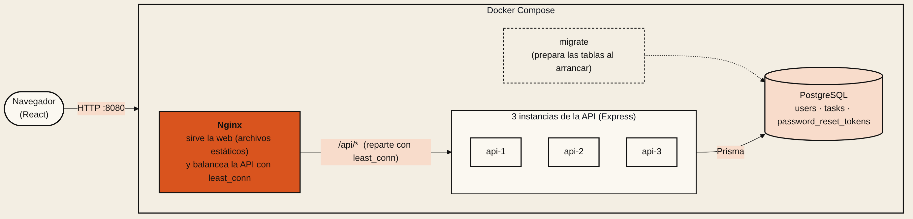
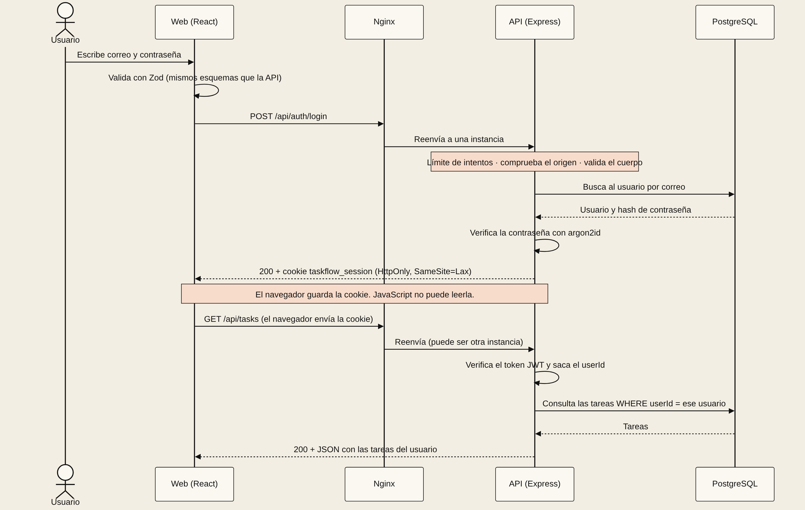
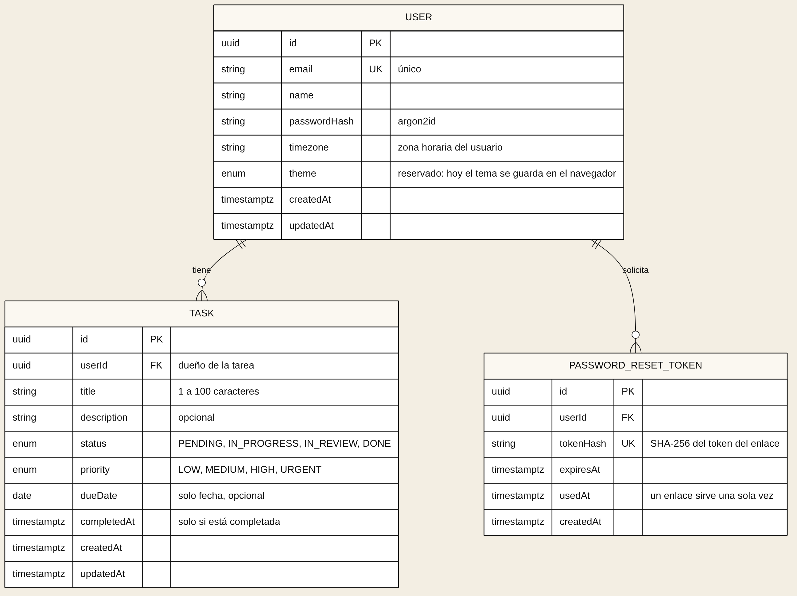
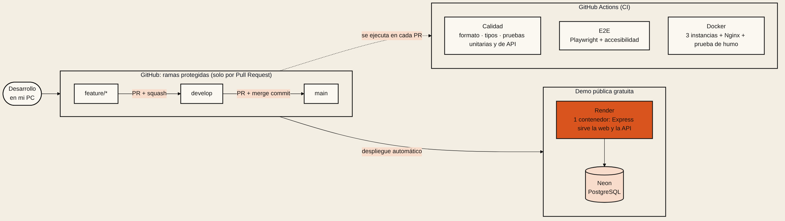
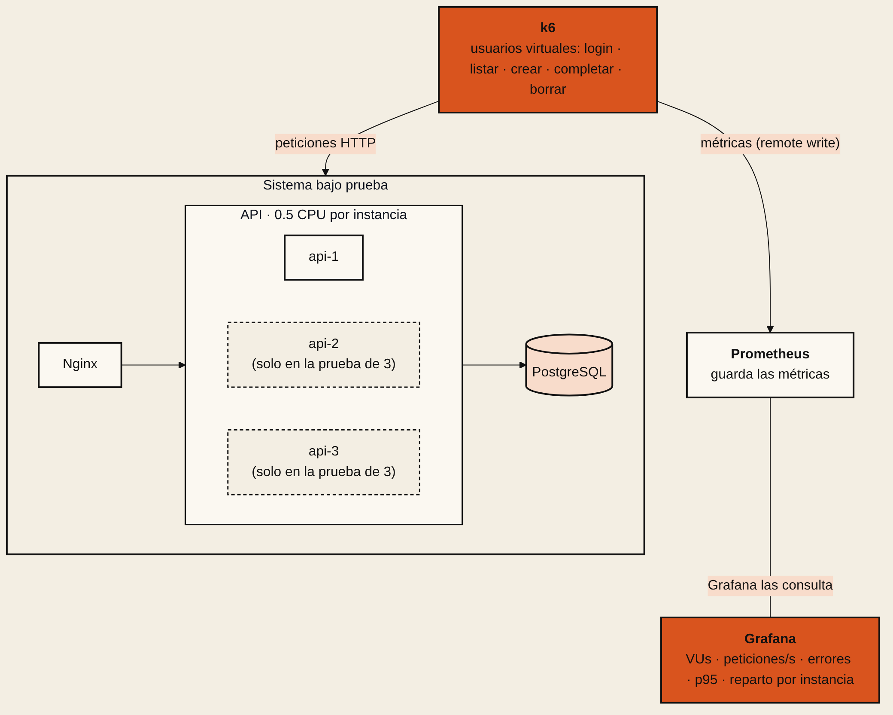

# Arquitectura de TaskFlow

Cinco diagramas que explican cómo está hecho TaskFlow. Cada uno viene como imagen (`.png` y `.svg`) y con su código fuente en Mermaid (`.mmd`) dentro de [`diagramas/`](diagramas/).

## 1. Arquitectura general

El navegador habla solo con **Nginx**. Nginx entrega la web (archivos estáticos) y reenvía todo lo que empieza con `/api/` a una de las 3 instancias de la API, la que tenga menos conexiones (`least_conn`). Las instancias no guardan estado: comparten la misma base de datos PostgreSQL, así que cualquiera puede atender a cualquier usuario. Un servicio `migrate` prepara las tablas al arrancar.

## 2. Inicio de sesión y peticiones protegidas

La contraseña se verifica con Argon2id y la sesión viaja en una cookie `HttpOnly` y `SameSite=Lax`, que JavaScript no puede leer. Como la cookie contiene un token firmado (JWT), cualquier instancia puede validarla sin consultar a las demás. Toda consulta de tareas se filtra por el `userId` de la sesión: nadie puede tocar las tareas de otra persona.

## 3. Modelo de datos

Tres tablas: usuarios, tareas y tokens de recuperación de contraseña. Un usuario tiene muchas tareas, y borrar al usuario borra sus tareas. De los tokens solo se guarda el hash (SHA-256), y un enlace sirve una sola vez. La columna `theme` del usuario está reservada: hoy el tema se guarda en el navegador.

## 4. Despliegue y flujo de trabajo

El trabajo se hace en ramas `feature/*` que entran a `develop` por Pull Request (con squash) y de ahí a `main` (con merge commit). Ambas ramas están protegidas: solo reciben cambios si el CI está en verde. Al llegar a `main`, Render despliega la demo, que corre en un solo contenedor y usa una base de datos en Neon.

## 5. Pruebas de carga

k6 simula usuarios virtuales contra Nginx y envía sus métricas a Prometheus. Grafana las consulta y las dibuja. Cada instancia de la API se limita a 0.5 CPU: así una sola se satura y se nota la mejora al pasar a 3.
